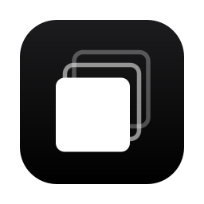

<p align="center"></p>

<h1 align="center">한컷 Hancut</h1>

<p align="center">비슷한 장면은 알아서 묶고, 장면마다 가장 좋은 한 컷만 건지는 RAW/JPG 셀렉 앱</p>

---

## 설치

**Homebrew**

```bash
brew install --cask duaghwns/tap/hancut
```

**curl**

```bash
curl -fsSL https://raw.githubusercontent.com/duaghwns/hancut-releases/main/install.sh | bash
```

직접 받으려면 [Releases](https://github.com/duaghwns/hancut-releases/releases/latest)에서 `Hancut-macos-arm64.zip`을 받아 `Hancut.app`을 응용 프로그램 폴더로 옮기세요. 브라우저로 받은 경우에는 처음 실행할 때 앱을 우클릭한 뒤 **열기**를 눌러야 합니다(Apple 공증을 받지 않은 앱이라서).

**요구 사항**
- Apple Silicon Mac (M1 이상), macOS 12 이상
- `exiftool`: 촬영 시각과 AF 위치를 읽는 데 씁니다. brew와 curl로 설치하면 자동으로 함께 설치됩니다.
- 처음 분석할 때 AI 모델(약 600MB)을 한 번 내려받습니다.

## 기능

- **장면 자동 묶기**: 촬영 시각과 AI 이미지 유사도로 연사·같은 포즈 컷을 한 장면으로 묶습니다.
- **베스트 컷 추천**: 인물·행사 사진 기준으로 초점, 눈 뜸, 미소, 정면, 노출을 보고 장면마다 1등을 고릅니다.
- **흔들림 판정**: 카메라에 기록된 AF 위치를 원본 해상도로 확인하고, 아웃포커싱이 아니라 정말 흔들린 사진만 골라냅니다.
- **빠른 셀렉**:
  - 키보드만으로 선택(Space), 제외(X), 별점(1–5), 휴지통(⌫), 되돌리기(⌘Z)를 할 수 있습니다.
  - AF 위치를 표시하고 확대해서 초점을 확인할 수 있습니다.
- **필터**: 흔들림, 눈 감음, 노출 문제 사진만 모아서 한 번에 정리합니다.
- **내보내기**: RAW 옆 XMP 파일에 별점을 기록합니다. 라이트룸과 캡처원에서 그대로 인식합니다.
- **프로젝트**: 촬영 폴더 단위로 진행 상황을 저장합니다. 분석 결과는 캐시되어, 다시 열 때 바로 열립니다.

지원 형식: CR3, CR2, NEF, ARW, RAF, ORF, RW2, DNG 등 주요 RAW와 JPG. AF 위치는 Canon을 실제 사진으로 검증했고, Nikon, Sony, Fujifilm은 지원하지만 아직 실제 파일로 검증하지 못했습니다.

## 삭제

```bash
brew uninstall --cask --zap hancut      # brew로 설치한 경우
```

curl이나 직접 설치한 경우에는 `Hancut.app`을 휴지통으로 옮기면 됩니다. 분석 캐시까지 지우려면 아래 폴더도 삭제하세요.
- `~/Library/Caches/Hancut`
- `~/Library/Application Support/Hancut`

---

이 저장소에는 배포용 앱과 설치 스크립트만 있습니다. © duaghwns. All rights reserved.
